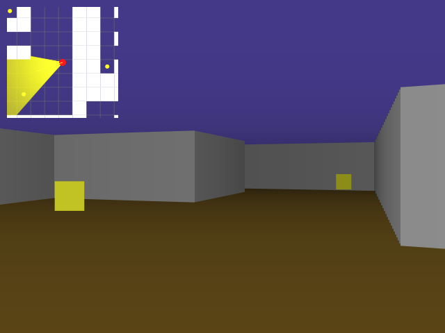
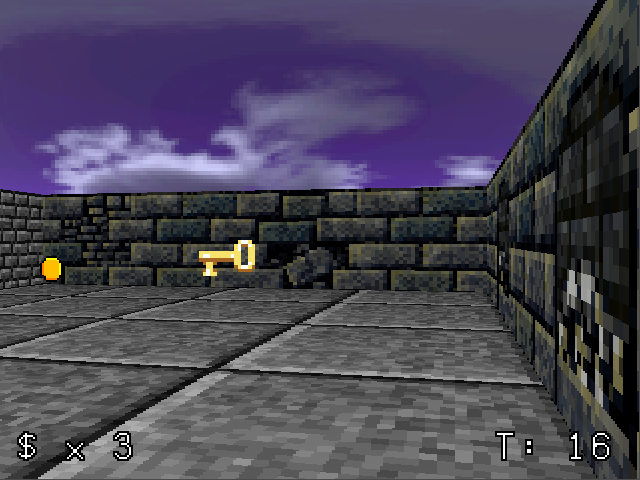

# Amazeman 3D
Example raycaster maze-escape game in JS.

### Demo

Watch:
- https://youtu.be/H2S6_e6Bfok

Play: 
- https://gamedevnull.itch.io/amazeman-3d

### Assets

Graphics:
- https://opengameart.org/content/simple-rotating-coin
- https://opengameart.org/content/simple-broad-purpose-tileset
- https://opengameart.org/content/dungeon-crawl-32x32-tiles
- https://opengameart.org/content/16x12-terminal-bitmap-font

Sounds:
- https://opengameart.org/content/key-pickup
- https://opengameart.org/content/door-lock-sounds
- https://opengameart.org/content/picked-coin-echo
- https://opengameart.org/content/picked-coin-echo-2

Music:
- https://opengameart.org/content/melodic-gentle-ambient-music

### Resources

Creating Pseudo 3D Games With HTML 5 Canvas and Raycasting: 
- [https://dev.opera.com/articles/3d-games-with-canvas-and-raycasting-part-1/](https://web.archive.org/web/20150323214131/https://dev.opera.com/articles/3d-games-with-canvas-and-raycasting-part-1/)

Lode's Computer Graphics Tutorial about Raycasting: 
- https://lodev.org/cgtutor/raycasting.html

Creating a DOOM (Wolfenstein) style 3D Game in Python: 
- https://www.youtube.com/watch?v=ECqUrT7IdqQ
